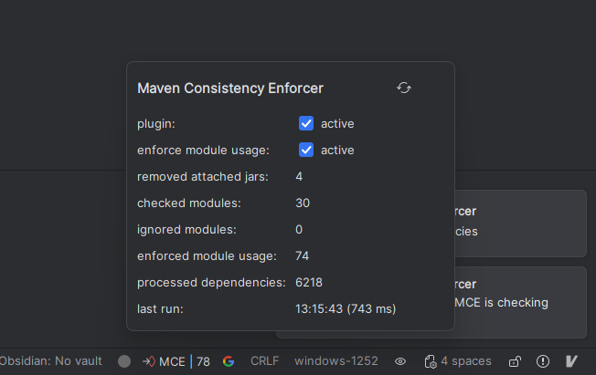
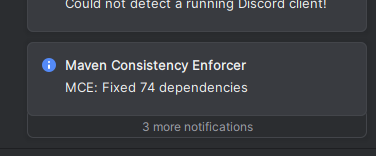
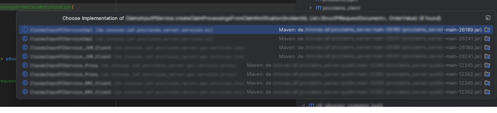
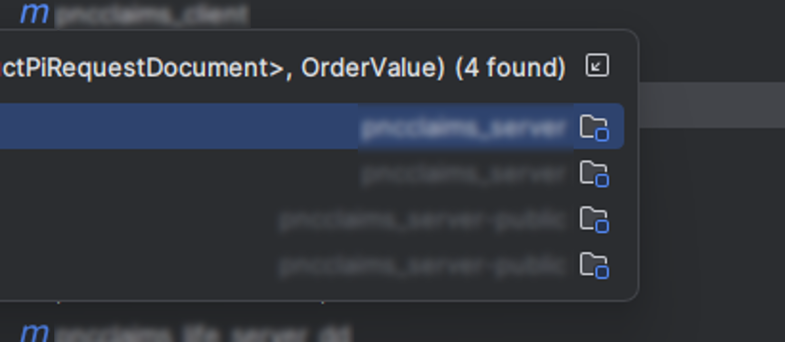
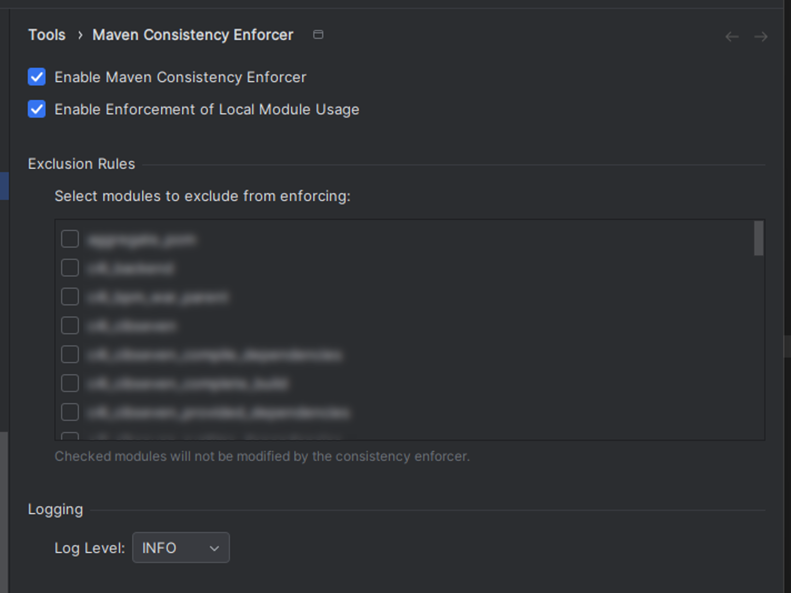

# Jetbrains Marketplace
[](https://plugins.jetbrains.com/plugin/31634)
[](https://plugins.jetbrains.com/plugin/31634)
[](https://plugins.jetbrains.com/plugin/31634)

# Maven Consistency Enforcer (MCE)

Stop fighting ghosts in your classpath! MCE ensures your IntelliJ IDEA run-time classpath matches the code in your workspace in multi-module Maven projects by detecting and removing stale JAR artifacts and preferring local module sources when available.

What it does:
- Automatically removes attached JARs that shadow local modules
- Replaces library entries with module dependencies when a matching module exists
- Per-module enforcement configuration and global "All modules" toggle
- Shows notifications and a status bar widget with enforcement metrics
- Ensures your local Maven repository paths are valid on startup
- Includes localization support
- Provides a persistence cache for faster operations
- Offers a Maven sync health check

### Post-reload automation pipeline

MCE is no longer tied to the pure Maven reload lifecycle. After enforcement runs, it can trigger
follow-up steps in a defined, observable order: `enforce ? compile ? run configurations`.

- Ordered, per-step pipeline you can enable/disable individually (settings are persisted per workspace)
- Conditional execution: follow-up steps run only when enforcement actually changed something (no-op reloads are skipped)
- Fail-fast: the pipeline stops on compile errors and surfaces them in a notification
- Debounce/throttle to avoid repeated runs on rapid successive Maven reloads
- Manual "Run Pipeline Now" action (Tools menu) to trigger the pipeline on demand
- Compile step: module-selective compilation (changed vs. all modules), test / without-test scope, and Build (make) vs. Rebuild semantics
- Run configuration step: launch one or more selected run configurations after a successful compile, in run or debug mode
- Searchable run-configuration picker in settings, with selection preserved across filtering
- Observability: per-step timing, compile error/warning counts and launched run configurations reported in the status bar widget popup

Default behavior:
- Triggers automatically after Maven > Reload Project and (optionally) on project startup
- Shows notifications about fixed dependencies
- Re-enforces consistency on every Maven reload
- `forceLocalModules` and repository health check will be questioned on first run
- The post-reload pipeline is opt-in: enable the steps you want in the settings

## Templated Workspaces

If you create and tear down workspaces frequently, handling repetitive configuration pop-ups can quickly become tedious. To automate this process and avoid manual confirmations, you can pre-configure your workspace templates. Simply include an mce-settings.xml file inside the template's .idea folder with your preferred defaults:
```
<?xml version="1.0" encoding="UTF-8"?>
<project version="4">
  <component name="dev.silverhorn.fca.maven_consistency_enforcer.settings.MceSettings">
    <option name="enforceModuleLinking" value="true" />
    <option name="runInitialHealthCheck" value="true" />
    <option name="mavenReloadType" value="FORCED" />
    <!-- Post-reload automation pipeline -->
    <option name="enablePostReloadPipeline" value="true" />
    <option name="onlyRunPipelineOnChanges" value="true" />
    <option name="failFast" value="true" />
    <option name="pipelineDebounceMs" value="2000" />
    <!-- Compile step -->
    <option name="enableCompileStep" value="true" />
    <option name="compileModuleScope" value="CHANGED_MODULES" />
    <option name="compileSourceScope" value="WITHOUT_TESTS" />
    <option name="compileType" value="BUILD" />
    <!-- Run configuration step -->
    <option name="enableRunConfigStep" value="false" />
    <option name="runConfigUseDebug" value="false" />
    <option name="postRunConfigurations">
      <list>
        <option value="My App" />
      </list>
    </option>
  </component>
</project>
```
> example in [mce-settings.xml](.idea/mce-settings.xml)

[//]: # (plugin-description-end)

## Screenshots

Below are a few screenshots illustrating MCE in action.

### Status bar widget
Displays enforcement state and quick toggles for the plugin.
<p align="center">
  
</p>

### Notification example
Informational notifications when the plugin fixes inconsistencies.
<p align="center">
  
</p>

### Before / After: Module enforcement
The plugin can replace library entries with local module dependencies. Examples (blurred to focus on the UI):
<p align="center">
  
</p>
<p align="center">
  
</p>

### Settings
Quick access to per-module enforcement configuration and the global toggle.
<p align="center">
  
</p>

